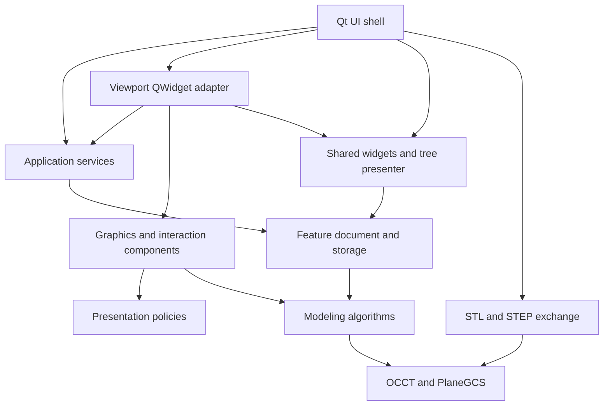

# TheCAD architecture

This is the owner-approved modular refactor of the accepted desktop application.
The modeling results, PlaneGCS solver, interactions, undo depth, schema 16 and
legacy-file compatibility remain the baseline. The modular refactor retained the
existing SDKs; STL/STEP export additionally uses their OCCT exchange toolkits.



## Components and ownership

| Component | Owns or implements | Must not own |
| --- | --- | --- |
| `modeling` | Sketch data/algorithms, constraints, dimensions, profiles, Booleans, reference math, persistent names, selection policy | Windows, widgets, document sessions |
| `document::PartDocument` | Ordered features, dependencies and transactional regeneration | Dialogs, GPU objects |
| `document::PartFileStore` | Existing JSON serialization, legacy migration and atomic saves | Active UI selection or editing commands |
| `exchange::ShapeExporter` | Geometry-only copies, STEP/STL translation and atomic target replacement | Widgets, active document/session mutation |
| `application::DocumentSession` | Document, editing draft, path, revision tracking, ten-action undo/redo | Widgets, renderer objects |
| `application::FeatureOperation` | Transactional extrusion/cut candidates and material-change results | PropertyManager controls |
| `application::SketchToolController` | Select/draw/dimension/relation activation | Mouse capture, cursors, drawing presentations |
| `viewport::GraphicsScene` | OCCT viewer, interactive context, native view lifetime and physical surface size | MainWindow, sketch edits |
| `viewport::CameraNavigation` | Gesture state, retained pivot, orbit/pan/zoom math | Entity selection, sketch mutation |
| `viewport::DimensionPresenter` | Dimension labels/guides and their scale | Driving constraints or document history |
| `viewport::SketchPicker` | Read-only screen-space tests with an injected projection | Camera navigation or document changes |
| `ui::FeatureTreePresenter` | Projection into the existing tree, expansion and selected occurrence | Persistent feature data |
| `ui::CadViewport` | Native QWidget event adapter and presentation coordination | Ownership of the extracted graphics/camera/dimension components' internal state |
| `ui::MainWindow` | Application composition, menus, dialogs, command wiring and window state | Ownership of session history/storage internals |

The UI facades keep their existing public interfaces and Qt object names. Existing
tool-specific event wiring and PropertyManager composition remain in UI adapters;
this is not a claim that every UI responsibility has become a separate class.
The tree remains the existing QTreeWidget view for interaction compatibility;
the feature document remains its authoritative data source.

## Build boundaries

Every source module declares its targets in its own `CMakeLists.txt`. Shared UI
widgets, viewport widget and shell are separate libraries. Lower rendering
components use Qt Gui/OCCT, with no QWidget or MainWindow dependency. The
application/document/modeling path uses no Qt GUI libraries.

`cmake/Architecture.cmake` checks target dependency direction at configure time.
`architecture.boundaries` scans includes in lower layers to reject UI imports.
The new session and viewport-component tests exercise their APIs directly. Core
and GUI tests continue to cover modeling and visible interaction behavior.

The default desktop build keeps the existing build/package commands and
`build/windows/Release/TheCAD.exe` output path. To configure a GUI-free build with
the same SDK prefix used by the normal build:

```powershell
cmake -S . -B build/headless -DCMAKE_PREFIX_PATH="<SDK Library directory>" `
  -DTHECAD_BUILD_GUI=OFF -DTHECAD_GUI_TESTS=OFF -DBUILD_TESTING=ON
cmake --build build/headless --config Release
ctest --test-dir build/headless -C Release --output-on-failure
```

The GUI-free core build excludes exchange and does not configure or link Qt
Widgets, Qt Gui or OCCT visualization components. The desktop exchange module
uses additional toolkits/resources from the pinned OCCT SDK; see decision 0030. Windows remains the supported platform. The optional installed
`clang-format` tool can apply the repository's `.clang-format` to new components;
it is not an application runtime dependency.

## Extending the application

Add geometry algorithms to modeling, persistent feature/regeneration rules to the
document, and reusable workflow operations to application services. Expose results
through typed values before wiring controls. Give rendering resources one explicit
owner. Keep screen projection and selection read-only; ordinary selection must
never navigate the camera. Preserve transactional validation before document
assignment and preserve source geometry during previews.

Choose a narrow component interface rather than passing MainWindow/CadViewport
into a lower-layer controller. Use the existing public facades for integration;
new tests can target the component directly. Document major decisions in
`docs/decisions/`. Do not change the saved format as an incidental refactor.

## Research and decision

[Decision 0028](decisions/0028-modular-architecture.md) records owner approval,
scope and the primary references: FreeCAD's App/Gui module separation, Qt's
model/view guidance and OCCT's application/document responsibilities. These inform
our boundaries; the current document implementation and SDK versions are retained.
