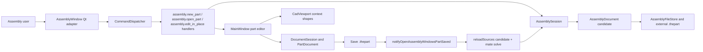
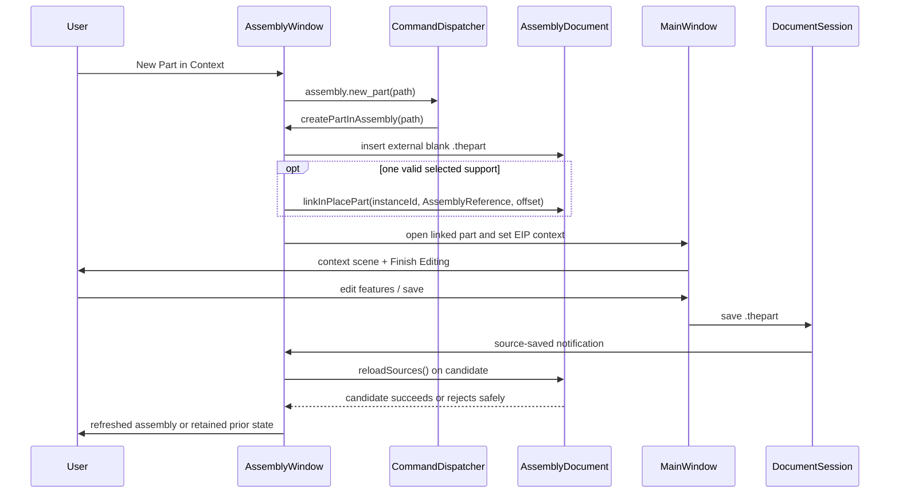
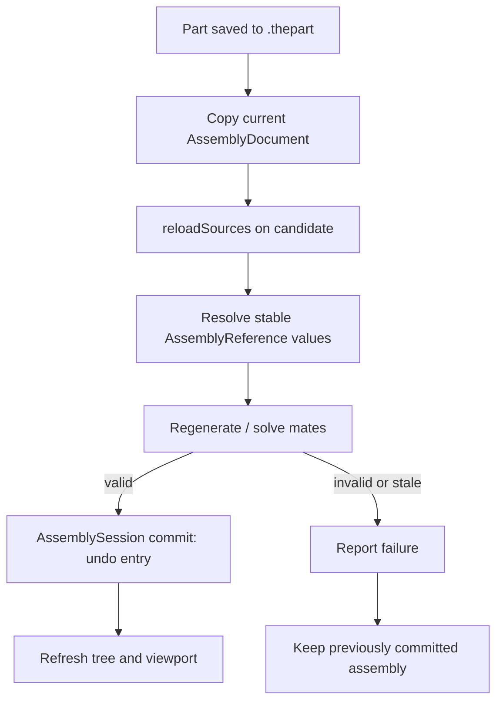

# Assembly architecture and workflow

## Milestone 2: associative cross-part sketch references

This milestone extends Edit In Place with explicit references from a linked
part's sketch to stable geometry in another visible linked component. The
active part remains an ordinary `.thepart`; the assembly continues to own
component instances, transforms and mates.

The supported source geometry is:

- Base origin, planes and axes.
- User datum planes, axes and points.
- Persistent sketch points, including circle centers and line endpoints or
  midpoints.
- Persistent straight sketch lines.

Solid faces and BRep edges are deliberately excluded. Their kernel topology
indices can change after regeneration, and this milestone does not add
persistent topology naming.

The **External References** sketch PropertyManager is available only while
editing a linked part in an assembly. It lets the user pick source geometry in
the context viewport or select it from the list, and explicitly choose
**Associative** or **Copy** mode. Associative references retain their source
component instance, source part path, source feature/entity IDs, point role,
source revision digest and owning assembly path. A copy stores projected
construction geometry without an update dependency. Breaking an associative
link removes only its link metadata and keeps the projected sketch geometry.

The source component's rigid transform is composed into assembly space, then
into the target component's local sketch frame before projection. Consequently,
multiple instances of the same `.thepart` remain distinct, and source and
target rotations/translations are accounted for. Sketch projections are
construction geometry and do not form profile boundaries.

On assembly rebuild or linked-source refresh, associative references are
resolved by exact component instance and stable source IDs. Updates run in
dependency order before affected features and mates regenerate. A missing or
changed source entity produces a diagnostic and preserves the last valid
dependent model; no fallback to another component or geometric neighbor is
allowed. Cyclic dependencies are rejected.

`ExternalSketchReference` metadata is stored in `.thepart` schema version 28.
Versions 1–27 remain readable. `.theasmb` was not changed. Document identity
continues to use the canonical linked part path plus the assembly component
instance ID, while feature/entity IDs identify geometry. A replaced file at
the same path is treated as the current definition of that component; its
stable source IDs and geometry type are revalidated. A future immutable
document UUID could distinguish replacement from edit more strongly.

## Milestone 1 scope

This document describes the independent-part assembly workflow added on top of
the existing `AssemblyDocument`, `AssemblySession`, `.theasmb` store, mate
solver and Part editing services. It does not replace the assembly model or add
a second part model. A part's `.thepart` file remains authoritative; an
assembly stores a linked component instance and its placement.

This milestone continues the local unified-workspace baseline `5fbd077`
(`codex/unified-main-build`) in the dedicated worktree branch
`codex/assembly-part-creation`. Older and concurrently edited worktrees were
left untouched.

## Reference workflow

Fusion's Edit In Place keeps an external component in its assembly placement,
shows the other components as context, and provides explicit associative and
non-associative reference modes. This implementation follows those interaction
principles while keeping TheCAD's existing mate solver and document structure.

- [Edit In Place](https://help.autodesk.com/cloudhelp/ENU/Fusion-Assemble/files/ASM-EDIT-IN-PLACE.htm)
- [Associative assembly references](https://help.autodesk.com/cloudhelp/ENU/Fusion-Assemble/files/ASM-REFERENCE-OBJECTS.htm)
- [Components](https://help.autodesk.com/cloudhelp/ENU/Fusion-Assemble/files/ASM-COMPONENTS.htm)
- [Assembly relationships](https://help.autodesk.com/cloudhelp/ENU/Fusion-Assemble/files/ASM-JOINTS.htm)

## Ownership and persisted data

`AssemblyComponent` is the per-instance record: stable instance ID, linked
source path and digest, immutable `PartDocument` definition, transform,
visibility/fixed state and cached reference geometry. Repeated instances can
share one in-memory part definition while retaining independent transforms.
The assembly file stores the source path relative to the `.theasmb` file and
existing v2 workflow metadata. The part feature history remains solely in its
`.thepart` file.

`InPlacePart` is the associative placement record. It stores the component
instance ID, stable `AssemblyReference`, rigid offset, and linked/local mode.
For this milestone, the supported associative behavior is that the selected
stable plane or planar reference drives the linked component's placement.
`AssemblyDocument::updateGeneratedParts()` resolves the support and updates the
component transform. Missing, stale or ambiguous references fail the candidate
update; they are never replaced with another reference. No persistent topology
naming or file-format migration was introduced.

The old embedded in-context-part and generated-belt workflows remain intact.
New independent parts use external `.thepart` documents. Blank part documents
are valid linked components, so a newly created part can be assembled before
it has a solid body.

## User workflow

1. **New Part in Context** asks for a new `.thepart` path. It reserves that
   path atomically and refuses to overwrite an existing file. Canceling the
   path picker has no effect. If writing, insertion, association, commit or
   editor startup fails, the component transaction is undone and the newly
   created file is removed. One selected stable assembly plane/reference is
   used for associative placement; with no selection, the part uses assembly
   origin placement. Ambiguous multi-selection is rejected.
2. The empty part is saved to disk, inserted as a linked component, and opened
   in the ordinary `MainWindow` with an Edit In Place toolbar. The active part
   stays in its assembly transform. Other visible components are shown in the
   part viewport as context geometry.
3. Context display can show surroundings, make them transparent, hide them,
   isolate the part, or show only components referenced by its placement
   association. Ordinary context remains presentation-only. While the explicit
   External References command is active, supported datum and sketch geometry
   from other visible components can be selected as a source; this mode cannot
   edit the source component.
4. **Finish Editing** invokes the `part.finish_edit_in_place` command and saves
   the active `.thepart`. Saving from the normal Save command also works. Open
   assembly windows reload linked paths through
   `AssemblyDocument::reloadSources()` and commit the refresh through
   `AssemblySession`, so the refresh has assembly undo/redo history. If source
   regeneration or mate solving fails, the previous assembly state remains
   committed and an error is reported. If an assembly draft is active when a
   linked part is saved, refresh is queued until that draft finishes.
5. **Open Part** opens the linked `.thepart` independently in the normal part
   editor. Saving it notifies open assemblies using the same refresh path.
   Existing independent editors are reused to avoid two unsynchronized
   documents for one path. Opening independently is blocked while that same
   file is currently being edited in place. Editing another part in place is
   blocked while a different EIP session is active in the same assembly window.

Part editors record the SHA-256 revision of the file they opened or last saved.
Saving over that same path is rejected if the file was replaced, changed or
removed since the editor loaded it. Save As can preserve the local edits as a
separate part; in Edit In Place it does not silently retarget the assembly
component.

The assembly viewport no longer fits the camera automatically after every
component update. Selection and source refresh therefore preserve the view the
user chose.

## Architecture and call flow

`AssemblyWindow` remains the assembly UI adapter and owns the assembly
dispatcher/session. `MainWindow` and `DocumentSession` remain the ordinary
part-editing stack. The dispatcher routes new UI actions using stable command
IDs; modeling and reference validation stay in document services. Existing
assembly features and workflows not yet migrated continue to use their current
handlers.

## Commands and UI entry points

The command catalog includes `assembly.new_part`, `assembly.open_part`,
`assembly.edit_in_place`, `assembly.refresh_references`,
`sketch.external_reference`, `sketch.break_external_reference` and
`part.finish_edit_in_place`. The assembly action and component context menu
submit Open/Edit requests through `CommandDispatcher`; there is one Open Part
entry, and it does not bypass document/session checks. The Rebuild action uses
`assembly.refresh_references`. The Edit In Place toolbar's Finish Editing
action uses `part.finish_edit_in_place`. `assembly.new_part` takes a required
`path` parameter. Open/Edit take a component ID from the request or current
selection. The handlers that create/show editor windows remain UI-bound; the
document-level association, refresh and serialization APIs themselves do not
require QWidget.

Existing assembly-only embedded-part and generated-feature commands remain
available through their existing workflow handlers; they are not claimed as
headless APIs in this milestone.

## Transaction and failure behavior

- Creating a part reserves a new file path without replacement, writes the
  blank part, then inserts and solves a candidate assembly. If insertion,
  association, commit or EIP startup fails, the part-file creation and latest
  assembly history entry are rolled back. Existing files are never overwritten.
- Linking an in-place support edits a candidate `AssemblyDocument`, validates
  the plane/frame reference and rigid offset, solves, then replaces the
  committed document.
- Refresh builds a candidate from saved source files, regenerates component
  references and resolves mates before committing through `AssemblySession`.
- Failed refresh does not replace the last valid assembly document.
- A successful linked-source refresh is an assembly history transaction. Part
  edits are recorded by the part's existing `DocumentSession` history.
- Same-path part saves compare the editor's saved file digest with the current
  file digest before writing. A revision mismatch or missing source blocks the
  save and reports the conflict, protecting another editor's saved work.
- Linked-source notifications arriving during an assembly draft are retained
  and applied automatically when that draft closes or cancels.
- Canceling the native file dialog performs no document mutation. There is no
  uncommitted geometry preview for creating an empty linked part.

## Tests

`tests/AssemblyExternalPartTests.cpp`, target
`thecad_assembly_external_part_tests`, verifies a non-GUI end-to-end document
path:

- saves and links a blank external part to stable datum geometry;
- saves/reopens `.theasmb` and checks the association is preserved;
- independently modifies and saves the `.thepart` with sketch/extrude history;
- moves the support reference and reloads the part source, confirming the
  linked instance follows the updated support;
- verifies session undo/redo around source refresh;
- verifies repeated instances share one immutable part definition and that a
  source update retains existing mate identities and component placement;
- verifies invalid/stale references and cyclic dependencies reject without
  replacing committed assembly state.

`tests/AssemblyWorkflowTests.cpp` exercises the Create New Part → EIP → Finish →
reopen assembly → Open Part → source refresh workflow through the command
dispatcher and Qt adapters. `tests/MainWindowTests.cpp` verifies that a stale
part editor cannot overwrite a newer on-disk revision. Viewport-dependent
assembly tests require a real Open CASCADE graphics context; run them on the
desktop for visual verification.

The cross-part tests cover sketch-point and datum associativity, sketch-line
copies, circle-center references, source-instance identity for repeated parts,
rotation/translation between component frames, source edits, copy isolation,
save/reopen, failed-update retention and circular-reference rejection.

## Adding assembly commands

1. Add a stable descriptor to `src/application/CommandSystem.cpp` and its typed
   parameters to the command request schema.
2. Bind the UI action in `AssemblyWindow::bindCommandHandlers()` or an
   assembly UI adapter, with availability based on the assembly context.
3. Keep geometry/document rules in `AssemblyDocument` and related modeling
   services, not in the handler or widget.
4. Mutate a candidate document and commit through `AssemblySession`; return a
   structured failure without partially changing the committed document.
5. Add a non-GUI regression in the assembly test target for ownership,
   references, save/reopen and undo/redo as applicable.

## Deferred work and limitations

- Arbitrary body-face and BRep-edge associativity remains unsupported. Stable
  datum and sketch sources are supported by the explicit reference workflow;
  surrounding body shading itself remains non-pickable.
- Only stable plane/frame support association driving component placement is
  implemented. Solid face references still reject uncertain regeneration;
  persistent topology naming is explicitly out of scope.
- Nested subassemblies are unsupported. `AssemblyComponent` stores a
  `PartDocument`; nested assembly support needs a component-definition and
  hierarchical instance-path design.
- A missing external source can still prevent assembly load; an unresolved
  component placeholder and relink UI are future work.
- The format has no immutable part-document UUID. This milestone identifies the
  source through its canonical linked path and exact assembly instance ID, then
  validates stable feature/entity IDs. Replacing a source at the same path is
  treated as an edit to that component; UUID-based replacement detection is a
  possible future file-format change.
- Mate solver/status behavior is retained. This milestone does not add new
  mate types or a solver redesign.
- EIP is currently one active editor context per assembly window. Context
  presentation does not update live while another source changes until the
  assembly is refreshed.
- The cross-part reference milestone is developed on
  `codex/assembly-cross-part-references`; it is not merged automatically.
