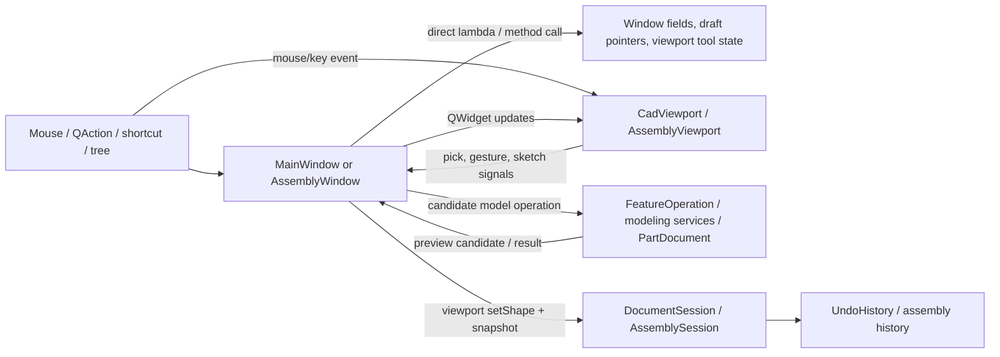
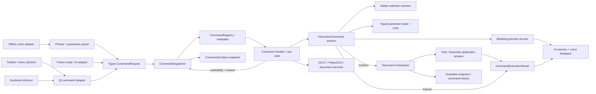

# TheCAD Command Architecture Audit

**Review date:** 2026-11-23
**Audited checkout:** local branch `codex/assembly-drag-mate-icons-point-picking`, commit `89b650d` (`Improve assembly drag and mate selection UI`)
**Scope:** research and architecture review only. No application source, behavior, tests, dependencies, or project data were changed. The audit follows the local checkout; the local branch is ahead of its remote tracking point. It does not assume that GitHub reflects the same application state.

## Executive assessment

TheCAD has a usable **layered application and modeling architecture**, but it does not yet have a unified command architecture. Most toolbar and menu actions are `QAction` objects connected directly to `MainWindow` lambdas. Sketch gesture commands are dispatched by `CadViewport` mouse and keyboard handlers. PropertyManager commands are stateful drafts owned by `MainWindow`; assembly commands use a separate window, session, action wiring, selection state, and history path.

Useful foundations already exist: modeling operations are generally below the Qt UI layer; `FeatureOperation` computes previews from document candidates; `DocumentSession` and `AssemblySession` keep application data/history out of widgets; sketch tools have a small controller; command bar groups use QAction-based UI; stable selection references exist in the modeling layer; and `tests/ArchitectureTests.cmake` enforces module import boundaries. These are good migration anchors, but the user-visible operations do not share a stable ID, request, context, enabled-state query, or lifecycle contract.

**Voice readiness:** voice could trigger a small subset by finding and triggering existing QActions, but that would be a brittle UI automation shim. It would not provide a supported, safe, non-UI invocation API for sketch gestures, PropertyManager fields, selection gathering, or transactional commit/cancel. A modest command layer is needed before voice can safely invoke the same operation as mouse and keyboard.

## 1. Repository and audit method

The audited commit is `89b650d`. The current branch is `codex/assembly-drag-mate-icons-point-picking`. At inspection, the tracked working tree was clean; there were two untracked owner items, `test_models/` and `untitled.tcpart`, which were left unchanged. The branch has no local `origin/codex/assembly-drag-mate-icons-point-picking` ref, so this audit uses the checked-out local commit rather than attempting a local/remote comparison by that ref.

The review read the startup, window, application session, document, modeling, viewport interaction, PropertyManager and test sources. It used `rg`, file inspection and Git metadata. No SolidWorks UI was inspected. No tests were run because this is a documentation-only task and the request prohibits functionality changes; tests in this repository include GUI workflows, which are outside this audit’s execution scope.

## A. Current architecture

### Layers and responsibilities

The source tree has real modular boundaries. CMake creates distinct targets for UI, viewport, presentation, application, document, modeling, exchange and related components. `tests/ArchitectureTests.cmake` checks that lower layers do not import UI/Qt widget dependencies and that selected inter-layer imports stay within policy. The constraint solver and OCCT modeling work therefore already have a path to remain independent of a future command API.

The separation is incomplete at the command boundary:

* `src/main.cpp` selects `MainWindow` versus `AssemblyWindow` from the file suffix and opens the requested document. Startup does not initialize or query a command registry.
* `src/ui/MainWindow.cpp` constructs most part commands and binds their `QAction::triggered` signals directly to lambdas, window methods, or viewport methods. Object names such as `actionExtrude` and `actionUndo` provide test hooks and informal identifiers, but are inconsistent and not backed by an application-level ID contract.
* `src/ui/MainWindow.h` is the orchestration hub for document, workspace mode, selected geometry, feature drafts, constraints, Smart Dimension, reference geometry, measure and many QAction pointers. `WorkspaceMode` coexists with booleans and nullable draft pointers, so availability is derived from a combination of state locations.
* `src/ui/CadViewport.*` owns camera/rendering and much of sketch picking and gesture execution. It emits signals such as `sketchChanged`, `sketchDeleteRequested`, geometry picks and dimension placement. The window listens and mutates the session/document. This works for mouse-driven UI but means the gesture-to-model operation has no uniform callable request object.
* `src/ui/assembly/AssemblyWindow.*` creates its own QAction set and its own action callbacks, selection/draft interactions and `AssemblySession`. It is not routed through the part command wiring or a shared command service.
* `src/application/FeatureOperation.*` is a useful non-widget service for generating a feature candidate and preview shape. It is not a general command interface and does not own the interactive operation lifecycle.
* `src/application/DocumentSession.*` owns the part document, optional active sketch, selected feature, file path, revision and ten-state edit history. `src/application/AssemblySession.*` has its own assembly history. Neither is a shared undoable command/transaction bus.
* `src/document/PartDocument.*` is the feature-history/document API. It can add, replace and delete feature definitions and regenerate geometry independently of Qt. That makes document-level operations callable, but the UI’s context checks, reference gathering and lifecycle remain separate.

### Command registration and activation

There is no central command registry, dispatcher or stable typed `CommandId`. The `addCommand` helper near `MainWindow.cpp:165` and the `action` helper near line 220 create Qt actions and connect each action directly to a callback. Some actions are disabled placeholders. Actions are also created in contextual menus, panels and assembly UI. Tests commonly find actions by `QObject::objectName`, showing that object names are useful conventions but not a formal API.

Keyboard shortcuts are mostly properties of QActions (`MainWindow.cpp:188–191`, `342–362`, `AssemblyWindow.cpp:310–354`, `448–459`). `QShortcut` is used in a local selection-cycle menu (`SelectionViewport.cpp:356–357`); sketch Delete/double-Delete behavior is handled in viewport key events (`CadViewport.cpp:1585` onward). Thus shortcut dispatch is partly QAction-driven and partly direct event handling. No command catalog can currently enumerate all such actions or return a common availability reason.

### Application and tool state

`application::SketchToolController` (`src/application/SketchToolController.h`) is a useful but narrow state helper for Select, Draw, Dimension and Relation modes. It holds the active drawing kind and construction flag. `CadViewport` owns/uses this controller and the toolbar synchronizes checked state by reading viewport mode in `MainWindow::updateSketchToolActions` (`MainWindow.cpp:967`). This is not a shared state machine for all application commands.

Other states live in `MainWindow::WorkspaceMode`, booleans such as `m_selectingPlane`, draft pointers (`m_operation`, `m_referenceDraft`, `m_solidFeature`, `m_sketchModifier`, `m_smartDimension`), measure QAction state, viewport selection/picking flags, and separate assembly draft state. `updateActions` (`MainWindow.cpp:974` onward) and several other UI routines compute enabled state from these fields. This means a future voice adapter would have to understand UI internals or duplicate those rules unless they are expressed through a shared context/availability service.

### Document changes, previews and history

Part feature operations commonly construct a candidate `PartDocument`, call `CadViewport::setShape` to validate/display it, and then commit it through `MainWindow::applyModel` (`MainWindow.cpp:833`). `applyModel` records a prior `DocumentSession::State`, replaces the document, sets the selected feature and refreshes the UI. This is a useful transaction-like pattern but is a MainWindow method, not a common transaction API.

Sketch geometry changes follow a different lifecycle. `CadViewport` previews mouse movement and emits committed sketch changes; `MainWindow::acceptConstrainedSketch` (`SketchConstraintsUi.cpp:28`) validates/solves a candidate, updates the active sketch, and records snapshots. Finish Sketch writes the edit back into the feature. `UndoHistory<State>` (`src/document/UndoHistory.h`) is a bounded snapshot deque (currently configured to 10 in `DocumentSession`), and `MainWindow::traverseHistory` (`EditHistory.cpp:27`) has UI-specific restore/display logic. Assembly uses separate mutation and undo/redo paths (`AssemblyWindow.cpp:595` and `AssemblySession`). There is no shared command stack that captures successful mutations across contexts.

Preview behavior is also not uniform. `FeatureOperation::preview` takes an immutable source document, feature definition and selected regions and returns a candidate plus preview shape. Extrude/Cut uses a `MainWindow::OperationDraft` and that service. Reference geometry and other features maintain distinct candidate structures and preview functions. Sketch drawing previews are viewport-owned. Measure is immediate/read-only. Cancellation and confirmation code therefore depend on which panel/controller is active.

### Selection

The modeling layer includes `modeling::Selection`/`SelectionRef` with typed selection kind and stable feature/entity references, and viewport picking uses `SketchPicker` plus OCCT selection. This is a strong basis for a UI-independent `CommandContext`. Today, however, actual selections are held by viewport/window-specific state; sketch point/entity picks, body contour-region picks, reference geometry picks, assembly component/geometry picks, and contextual tree selection have different representations and flows. Some selected items are snapshot `TopoDS_Shape`s, while others are stable IDs plus generation/topology metadata. A future request must define how references resolve and fail when stale rather than pass raw UI objects.

### Current command flow

The diagram reflects two execution entry points: direct UI action callbacks and direct viewport event handling. The session and modeling layers are reusable, but the command lifecycle crosses both UI objects.

## B. Command inventory

“Programmatic” below means callable without simulating a mouse click. It distinguishes model/service APIs from a supported user-level command entry point. “Undo” refers to document mutation history; view/measure operations are intentionally not document edits.

| Command | Definition and activation | Parameters and required context | Preview / commit / cancellation | Undo / programmatic / stable ID / concerns |
|---|---|---|---|---|
| **Create Sketch** | `MainWindow::createSketch`, `createSketchOnPlane`, `createSketchOnFace` in `src/ui/MainWindow.cpp:1056–1122`; QAction `actionCreateSketch`; viewport/tree selection enters sketch-plane selection. | Requires part workspace with no active sketch/draft; selected base/reference plane, planar face or selected feature. Geometry is selected through viewport/tree and the sketch plane is stored on the sketch. | Sketch plane/edit mode and viewport are set up; there is not a solid-operation preview. Escape cancels plane selection; Finish Sketch writes the edit into the feature. | `PartDocument::addSketch` is callable directly; no unified command invocation. Creation goes through `applyModel` and session snapshot history. `actionCreateSketch` is only an informal ID; automatic first-plane click behavior is additional UI state. |
| **Line** | QAction `actionLine` from `MainWindow.cpp:267–299` calls `CadViewport::setSketchTool`; gesture methods in `CadViewport.cpp:736`, `1175`, `1280`, `1436`. | Requires editing sketch. Parameters are snapped sketch-plane points, relation references and construction flag; collected via viewport and snapping/picking. | Live rubber-band/constraint preview in viewport. Click commits a line; Escape resets/exits current draw interaction. Each accepted sketch change flows through `acceptConstrainedSketch` and session history. | Underlying sketch/modeling entity operations can be called directly, but there is no equivalent command request for viewport gesture creation. UI identifier is `actionLine`. Document mutation is partly initiated inside event-driven flow. |
| **Rectangle** | QAction `actionRectangle` via the same toolbar helper; `CadViewport` gesture and `commitDrawing` path as Line. | Requires editing sketch; first/second corners plus snap/relations and construction state. | Live rectangle preview; click completion emits sketch change and solver acceptance. Escape is handled by viewport/tool state. | Lower-level sketch entity API is callable; no uniform command endpoint. ID `actionRectangle`. Shares gesture implementation but rectangle constraints/entity generation follow a distinct code path. |
| **Smart Dimension** | QAction `actionSmartDimension` calls `MainWindow::startSmartDimension` (`src/ui/SmartDimensionUi.cpp:38`); viewport emits reference/pointer/placement signals. | Requires active sketch, no conflicting operation. Selects entity/point/body reference; dimension type inferred. Numeric value and driving/reference option entered in `smartDimensionEditor` QDialog. | `updateSmartPreview` previews inferred dimension; placement opens editor. Accept changes sketch through constrained-sketch path; Escape closes/cancels/reset selection. Existing dimension is edited on double-click. | Modeling dimension API is directly callable; complete interactive command depends on viewport signals and dialog widgets. Undo via sketch snapshots. ID `actionSmartDimension`; numeric voice input has no stable parameter schema and would need to find/focus an active widget. |
| **Extrude** | QAction `actionExtrude` -> `MainWindow::extrude(false)` -> `startOperation` (`MainWindow.cpp:1284`); `OperationDraft`, property panel and region picking. | Requires a valid sketch/profile and part context. Parameters include sketch/contour, depth/direction and feature options; geometry selection comes from current sketch or viewport region click. | `updateOperationPreview` (`MainWindow.cpp:1553`) uses `application::FeatureOperation::preview`. Confirm calls candidate commit via `applyModel`; Cancel/escape calls `finishOperation(false)` and clears preview. | `FeatureOperation::preview` and `PartDocument` APIs support programmatic modeling. Interactive lifecycle/selection stays window-owned. Undo through `DocumentSession`. ID `actionExtrude`; typed parameter schema and result status are missing. |
| **Extruded Cut** | QAction `actionExtrudedCut` -> `MainWindow::extrude(true)` -> shared OperationDraft path. | Same profile requirement; body must exist. Cut depth/direction/termination/options and selected contour. | Preview candidate; accept applies transaction, cancel drops it. UI routes Enter/Escape/button events through operation handlers. | Same service capability and undo path as Extrude. ID `actionExtrudedCut`; shares much but not all precondition logic; user intent “Cut” is not a stable alias/ID. |
| **Reference Plane** | QAction `actionReferencePlane` -> `MainWindow::startReferenceGeometry(Plane)` (`ReferenceGeometryUi.cpp:33`). Reference selection comes from viewport or FeatureManager. | Requires valid datum references or XYZ/direct parameters. Method can be automatic or explicitly selected; parameters include source refs, offset/angle, direction and direct position where relevant. | `updateReferenceGeometryPreview` (`ReferenceGeometryUi.cpp:131`) builds a candidate datum and visible preview; OK -> `finishReferenceGeometry(true)` commits; Cancel/Esc discards draft. Existing datum feature can be edited. | `PartDocument::addReferenceGeometry` is callable if caller builds a valid `DatumDefinition`. Undo via `applyModel`. ID `actionReferencePlane`; automatic method inference and selection requirements are currently coupled to dialog/viewport. |
| **Measure** | Checkable QAction `actionMeasure`; `setMeasureActive` and `refreshMeasurement` in `src/ui/MeasureUi.cpp:85–111`. | Requires body selection (one/two faces, edges, or vertices) and no feature/sketch draft. Unit, precision, XYZ and circular-edge mode are UI controls. | Immediate readout and viewport annotations; no document commit or confirmation. Deactivate toggles selection mode/panel off. | `modeling::measureGeometry` is directly callable for shapes; command selection and current result are UI-specific. No undo (read-only). ID `actionMeasure`. It is a good read-only example of a pure service plus UI adapter. |
| **Undo / Redo** | `actionUndo`/`actionRedo`, Ctrl+Z/Ctrl+Y in `MainWindow.cpp:188–191`; calls `MainWindow::traverseHistory` (`EditHistory.cpp:27`). Assembly has separate QActions and session history in `AssemblyWindow.cpp`. | Requires the appropriate active document/session and no incompatible draft; enablement is updated by `updateHistoryActions`. | No preview. Restores historical snapshot after checking the target shape can display. Some in-progress modes are closed/reset before restore. | `DocumentSession` and `UndoHistory` are callable at application level, but UI must coordinate viewport and sketch modes. Part and assembly history are distinct. IDs exist as object names only; no cross-document/history command contract. |
| **Delete** | Feature/reference Delete QAction `actionDeleteFeatures` from `SelectionUi.cpp`; viewport Delete/double-Delete emits `sketchDeleteRequested` (`CadViewport.cpp:1585–1605`) to `MainWindow::deleteSketchEntity`. | Selection depends on context: feature tree/reference geometry in part mode, dimensions/relations/entities in sketch mode, and other selection routes in assembly. Dependent-feature deletion uses a confirmation prompt. | No preview; some paths confirm dependencies. Mutation uses `applyModel` or sketch accept/solver path; Escape is not applicable. | `PartDocument::deleteFeatures` and sketch deletion services are callable, but user-visible delete is split among at least two paths and assembly has its own. Undo is supported for documented session paths. Feature and sketch deletion do not share a stable request schema. |
| **Isometric / Normal To** | QAction `actionIsometric`/`actionView*`/`actionNormalTo` connected directly to viewport (`MainWindow.cpp:342–362`); normal-to method in `NavigationViewport.cpp:108`. | Viewport required. Normal To reads selected face or active sketch plane. | Immediate camera transition; no preview or document mutation. | Can be invoked directly on `CadViewport` but not via app-independent command API. Action object names are stable-ish, operation is inherently viewport-specific and should live in a view command service/adapter. No undo. |
| **Confirm / Cancel** | Feature/ref/modifier panels wire dialog buttons to distinct finish methods. Escape action `actionCancelFeature` in `MainWindow.cpp:595–597` uses an `if/else` chain; viewport handles sketch-tool escape separately. Enter handling is spread across `operationKeyEvent`, `referenceGeometryEvent`, `solidFeatureEvent`, and sketch handlers. | Requires knowing which draft/tool is active and which input currently has focus. | Feature managers typically preview then confirm/cancel; sketch drawing has different completion rules; Smart Dimension has its own dialog. | No general API. Not document commands by themselves, but commit/cancel are essential lifecycle operations. Escape ownership/order is inconsistent; voice phrases “confirm” or “cancel” could target the wrong active mode without a unified active-session query. |

### Command implementation observations

* A command-like concept is implemented in at least four different ways: QAction callback, viewport event handler, PropertyManager draft, or service/model operation. Often a complete workflow crosses all four.
* Toolbar QAction `objectName` values help tests locate UI actions (`tests/MainWindowTests.cpp`, `ModelingWorkflowTests.cpp`, `AssemblyWorkflowTests.cpp`) but tests do not indicate a general command registry. Some tests deliberately trigger `QAction` by object name, which can be retained behind a future dispatcher adapter.
* Command availability is recomputed in `MainWindow::updateActions`, action-specific enable logic, draft constructors, and selection/panel handlers. Assembly computes its own action state. There is no `canExecute(command, context)` result with a reason for unavailable commands.
* Parameter schemas do not exist independently from widgets. Spin boxes, checkboxes and combo boxes are the operational parameter store for several commands. A voice phrase can only set values by locating and manipulating those UI objects.
* Preview, confirm, cancel and undo are not one consistent lifecycle. The document candidate pattern is promising, but interactive sketch state, feature panels, reference geometry and assembly use different transaction ownership.
* A limited number of actions such as Fit, Isometric and Undo can be triggered without mouse simulation by triggering a QAction programmatically. This is Qt-level automation, not UI-independent invocation. Modeling functions and some `PartDocument` operations are callable without widgets but bypass unified context and enabled-state checks.

## C. Voice-readiness assessment

### What can be reused

1. **Layered service/model targets.** Lower modeling/document layers are already separated from Qt widgets by architecture checks. Keep PlaneGCS and OCCT work below command adapters.
2. **Document sessions and bounded history.** `DocumentSession` already provides a snapshot boundary and ten-step history; `AssemblySession` provides an independent assembly path. Both can back undoable command transactions after a unified command entry point exists.
3. **Candidate feature preview.** `application::FeatureOperation::preview` demonstrates computing from a source document and returning a preview result without directly owning widgets.
4. **Stable selection references.** Modeling selection types and stable feature/entity IDs can form a UI-independent selection snapshot. For B-Rep entities, resolution must validate the topology/generation key and return “stale/ambiguous” instead of silently selecting a different subshape.
5. **Qt actions are reusable adapters.** Existing toolbar/menu actions can remain and dispatch typed requests rather than be discarded. QAction can continue to own display, shortcut and enabled/checked appearance.
6. **Tests cover real workflows.** Tests already trigger actions by object name and assert undo/redo, selection and feature behavior. Similar tests can assert stable command IDs/availability and dispatch without widget input.

### What is missing

* A canonical stable command identifier and catalog, including aliases (“Cut” -> Extruded Cut) and namespaced operations (part/sketch/assembly/view).
* A typed command request/parameter schema separate from QWidgets, with units and dimension parsing represented as values rather than spin-box state.
* An immutable execution context that reports active document/workspace, selection, active interactive command, units, and valid reference resolution.
* A single availability/precondition check that is shared by UI, shortcut, voice and future scripting/AI calls, with a user-readable refusal reason.
* A command dispatcher with a result type distinguishing committed, started-interactive, needs-input, canceled, rejected and failed outcomes.
* A consistent multi-step interaction lifecycle for selection gathering, parameter changes, preview, confirm and cancel. Many CAD commands are not one-shot; voice must be able to say “Extrude”, then “25 mm”, then “Confirm” while addressing exactly one active draft.
* A common transaction boundary for document mutations; successful commits become undoable atomically, previews stay outside history, and cancel leaves document state untouched.
* A policy for ambiguous/stale selection, missing units, destructive changes and confirmation. The system must not guess which of two selected faces or open feature panels a voice phrase refers to.
* UI feedback from command results: recognized intent, parameter interpretation (e.g. “25 mm”), preview state, unavailable reason and commit completion.

### Safe voice interaction rules

For a first implementation, use constrained command phrases and explicit typed slots. A voice adapter should call `availableCommands(context)` before dispatch; resolve spoken geometry references only against the current stable selection; reject ambiguous or stale references; parse lengths/angles with document units and report the normalized value; and never treat an incomplete transcript as confirmation. Destructive or geometry-changing commands should open the normal preview and require an explicit “Confirm” unless the user has explicitly approved a one-step action class. “Cancel” should target only the currently active interactive session. A command that is unavailable should report why instead of silently toggling a tool or changing document mode.

For “Isometric”, dispatch can complete immediately. For “Extrude”, dispatch should start the interactive session; a later parameter phrase changes the session parameters; preview/availability is re-evaluated; “Confirm” commits one transaction. This separation prevents activation from being confused with confirmation.

## D. Recommended architecture

Use a thin application-level command layer, not a framework with a class hierarchy for every button. The source of truth should be an application-owned catalog of descriptors and handlers; Qt `QAction`, keyboard, future voice and scripting adapters create the same typed request. Interactive tools are sessions with a small explicit state machine. Modeling services remain plain C++ and do not include QtWidgets.

### Suggested responsibilities

| Component | Responsibility | Keep out |
|---|---|---|
| `CommandId` and descriptor | Stable namespaced ID, label, aliases, context category, parameter description, interactive/read-only classification. | Widget pointers, model algorithms. |
| `CommandRegistry` | Register descriptors/handlers once; enumerate commands and metadata. | Global mutable current document/tool state. |
| `CommandContext` | Read-only snapshot: document kind/session ID, workspace, selected stable references, active interactive session, units and capabilities. | `QWidget*`, event objects, stale raw OCCT selections without validation. |
| `CommandRequest` | Command ID plus typed arguments and optional expected selection/context version. | Display strings used as the only parameter representation. |
| `CommandDispatcher` | Resolve ID, check availability, validate request, route to handler, return result/reason. | CAD algorithms and presentation. |
| Command/use-case handler | Execute a one-shot app operation or start/advance an interactive session. Calls application/modeling services. | QAction creation and dialog layouts. |
| `InteractiveCommand` | Explicit states such as selecting references, editing parameters, preview-ready, committed/canceled/failed. | Owning document history or GUI widget implementation. |
| Transaction/history boundary | Validate candidate, atomically commit document state once, record exactly one undo step, rollback failed commit. | Previews and transient selection/camera state. |
| UI adapter / PropertyManager binder | Translate QAction, shortcut, picks and widget edits into requests/session inputs; render state/result. | Business rules duplicated from dispatcher. |
| Voice adapter | ASR transcript -> deterministic phrase/slot parse -> request; return spoken/visible status. | Directly calling Qt widgets or model operations. |

### Command result and lifecycle

A small `CommandExecutionResult` should distinguish at least: `Rejected` (unavailable/invalid plus reason), `StartedInteractive` (session token), `NeedsInput` (which parameter/selection), `PreviewUpdated`, `Committed` (affected IDs and undo entry), `Canceled`, and `Failed` (safe rollback). This avoids encoding command state in button checkmarks or modal dialog existence.

Use stable IDs such as `sketch.line`, `sketch.rectangle`, `sketch.smart_dimension`, `feature.extrude`, `feature.extruded_cut`, `reference.plane`, `inspect.measure`, `edit.undo`, `edit.redo`, `view.isometric`, `view.normal_to`, `command.confirm`, `command.cancel`. Names are suggestions for approval, not existing IDs.

The first dispatcher should not swallow all UI logic. Introduce it as a façade over existing handlers and migrate one operation at a time. Keep view navigation as UI/application commands that require a viewport-capable context; keep document mutations in application/document services.

## E. Latency investigation and measurement

The 300 ms median / 500 ms p95 target is end-of-speech to command activation and is not guaranteed by this audit. Latency should be measured by component rather than inferred from total response:

| Segment | Start/end timestamps | Main factors | Measurement recommendation |
|---|---|---|---|
| Recognition | audio end/VAD endpoint -> final transcript | endpointing delay, model size, CPU contention, decoder, sample rate | Use monotonic clock at audio capture and final transcript; log endpointing separately from decode. |
| Interpretation | transcript -> validated intent/request | grammar/slot parsing, unit normalization, selection disambiguation | Benchmark deterministic parser alone with representative phrases and invalid/ambiguous cases. |
| Dispatch | request received -> handler state/activation | registry lookup, context snapshot, availability checks, UI thread queueing | Add monotonic timestamps around dispatcher and handler; should be small and synchronous for ordinary command activation. |
| Modeling | handler start -> candidate/preview/commit result | PlaneGCS solve, OCCT regeneration/tessellation, feature complexity, B-Rep topology | Instrument service boundaries per operation; report cold and warm runs and p50/p95. Avoid putting feature computation on ASR callback thread. |
| Viewport/UI | result -> visible preview/feedback | event-loop delay, recompute, AIS updates, GPU render/present | Record UI-thread receipt and paint/present proxy timestamps; separate preview generation from rendered feedback. |

For command parsing and dispatch, there should be no network dependency and no general-purpose AI/LLM inference in the real-time path. A preloaded local recognizer should stream partial hypotheses, use VAD/end-of-speech to finalize, and hand only text/slots to a small deterministic grammar. The dispatcher can synchronously activate most tools on the UI thread. Expensive geometry calculations need a separate measured path: compute from an immutable document snapshot off the UI thread only where OCCT/PlaneGCS usage is safe, then validate the document version and apply/commit on the owning thread. Do not assume every OCCT operation can safely run concurrently without specific API review.

## F. Offline speech-recognition options (not selected)

No engine was installed or tested. The official project sources support this high-level comparison:

| Engine | Windows / native fit | Streaming and constrained vocabulary | Runtime and licensing | Assessment for TheCAD |
|---|---|---|---|---|
| **sherpa-onnx** | Project documents C++ and Windows/x64 support and includes a C++ microphone streaming example. | Supports streaming ASR and keyword spotting; selected model/decoder support determines constraints. | Apache-2.0 repo; model and ONNX Runtime packaging/version/licensing must be reviewed for a chosen model. | Strong first POC candidate if streaming C++ integration and cross-platform options are priorities. More moving parts and model/runtime packaging than a single source file. [Project](https://github.com/k2-fsa/sherpa-onnx), [C++ API examples](https://github.com/k2-fsa/sherpa-onnx/tree/master/sherpa-onnx/csrc). |
| **Vosk** | Official project provides C API and offline SDK direction; Windows packaging/build details should be verified against the exact x64 release before adoption. | Offline streaming API and vocabulary reconfiguration are documented; grammar adaptation is possible but exact restrictions depend on model/API. | Apache-2.0 API; model assets and native binaries must be included/licensed appropriately. | A good lightweight command-vocabulary comparison candidate. Its speech models vary substantially in size and accuracy; benchmark target phrase recognition with TheCAD vocabulary before choosing. [Official site](https://alphacephei.com/vosk/), [API](https://github.com/alphacep/vosk-api). |
| **whisper.cpp** | Native C/C++ project with Windows build support. | Has a real-time microphone stream example, but the README describes it as a naive repeated transcription loop; it is not primarily a constrained-command recognizer. | MIT project license; model weights and bundled runtime/build components need a separate license/deployment review. | Useful offline baseline for robustness to natural phrasing; less aligned with the strict low-latency, 20-command grammar target. [Project](https://github.com/ggml-org/whisper.cpp). |

Sources reviewed: official repositories and project documentation linked above. sherpa-onnx describes offline and streaming support, Windows/x64 and C++ support; Vosk describes offline operation, a streaming API, vocabulary reconfiguration, 20+ languages and portable model sizes; whisper.cpp documents C/C++ implementation, MIT license and a microphone streaming example. [sherpa-onnx](https://github.com/k2-fsa/sherpa-onnx), [Vosk](https://alphacephei.com/vosk/), [Vosk API](https://github.com/alphacep/vosk-api), [whisper.cpp](https://github.com/ggml-org/whisper.cpp).

**Recommended future POC, not an engine decision:** after command IDs and dispatch exist, build a separate optional voice adapter that recognizes approximately 20 intents across View, Sketch and Edit (e.g. Isometric, Normal To, Line, Rectangle, Circle, Smart Dimension, Undo, Redo, Cancel, Confirm). Include typed slots for lengths/angles and direction words. Benchmark sherpa-onnx and Vosk on the same saved audio set and live desktop, with local models loaded before the command is spoken. Do not initially allow unrestricted model feature generation or voice-only confirmation of a destructive feature.

## G. Architectural risks (highest rework first)

| Priority | Finding | Consequence for voice/scripting and future work |
|---|---|---|
| **P0** | No stable command ID/registry/dispatcher. | A voice, plugin or AI layer would call QActions by object name or duplicate command behavior; UI renames/refactors become API breaks and no complete command list can be queried. |
| **P0** | Interactive state is split across MainWindow fields, viewport modes, QAction checks and panel drafts. | Voice cannot reliably tell whether “25 mm” belongs to an extrusion, dimension editor, reference datum or another numeric field. Confirm/Cancel risks addressing the wrong operation. |
| **P0** | Widget state is the parameter source for PropertyManager workflows. | Non-UI invocation would need to simulate/focus widgets; validation and units are hard to share, and programmatic clients cannot reliably preview/commit. |
| **P1** | Selection is represented differently across tree, sketch picker, body contour, reference geometry and assembly workflows. | Natural references may become stale or ambiguous; a future command context must normalize stable references while preserving topology identity and explicit ambiguity failures. |
| **P1** | Mutation and history ownership vary by feature, sketch and assembly. | A command may be visible to the user without one atomic undo step, or failure after partial mutation may require special cleanup. Voice needs predictable commit/cancel and undo results. |
| **P1** | Availability/validation logic is distributed. | UI and voice can disagree about whether a command is valid; a voice-triggered command might activate in the wrong workspace or when its required selection is absent. |
| **P2** | Confirmation/cancellation are duplicated across event filters, buttons, dialogs and viewport key handlers. | Escape/Confirm semantics can be inconsistent and become difficult to test without a GUI. |
| **P2** | Direct mouse handlers contain gesture-to-operation sequencing. | Scripts/voice cannot express sketch steps without simulated pointer input; intentional geometric picks should be first-class request inputs while interactive mouse remains an adapter. |
| **P2** | Part and assembly use parallel command/action/history architectures. | New common behaviors (Undo, Delete, Mate, Measure, context-aware enabled state) risk further duplication unless command metadata/context works across document kinds. |
| **P3** | Some commands are inherently view-dependent and command availability is not queryable. | Non-UI execution needs an explicit view capability and camera context; some calls should be rejected when no viewport exists rather than faking a view. |

`MainWindow` is large, but the immediate problem is not file size by itself. Moving methods into more source files without a shared command/context/transaction contract would only distribute the current coupling.

## H. Incremental migration roadmap

All stages preserve existing functionality and allow old callbacks to coexist as adapters. Keep PlaneGCS, OCCT operations, feature history, document format and current session types intact unless a separately approved need emerges.

### Stage 0 — Freeze inventory and invariants

**Work:** Treat this audit as baseline; create a command/interaction inventory for Part, Sketch, Assembly and View contexts; document current shortcuts, QAction object names, enabled rules, active drafts, cancellation and history effects.
**Depends on:** This review.
**Acceptance:** Inventory covers every enabled action and mouse-only command; current behavior is represented in existing regression/workflow tests; no production changes.

### Stage 1 — Stable IDs and metadata catalog

**Work:** Add namespaced `CommandId` constants and descriptors for enabled commands, labels/aliases, context kind and interaction classification. Initially QActions keep their existing callbacks; metadata can be associated with each QAction. Add an audit assertion that no enabled action lacks an ID. Disabled placeholders are explicitly marked unavailable rather than offered to voice.
**Depends on:** Approval of application-owned IDs/catalog as canonical.
**Acceptance:** IDs are unique, stable across UI labels, enumeratable in a test without displaying windows, and existing QAction-based tests still pass.

### Stage 2 — Shared context and availability query

**Work:** Define immutable `CommandContext` containing active document/workspace, selected stable references, units, active command session and available capabilities. Implement descriptor/handler availability with a reason. Adapt UI enabled/check state to this shared result incrementally.
**Depends on:** Stage 1; selection and session adapters.
**Acceptance:** A test can query command availability for Part, Sketch, feature draft and Assembly contexts without a dialog; UI enablement matches the query for migrated actions.

### Stage 3 — Typed parameters and consistent interactive lifecycle

**Work:** Introduce typed request parameter structs and command result outcomes. Start with low-risk commands and a single PropertyManager operation (recommend Extrude/Cut): begin, update selection/parameters, preview, commit, cancel. Have widgets bind to this model rather than own semantic state. Preserve current input and preview behavior.
**Depends on:** Stages 1–2; explicit owner choice for interactive session semantics.
**Acceptance:** Invalid input is rejected before document mutation; preview does not create history; confirm creates one undo step; cancel preserves the prior document; UI and programmatic tests exercise the same handler.

### Stage 4 — Unified transactional document mutations

**Work:** Route sketch geometry, dimensions, feature creation/deletion, references and assembly changes through application transaction boundaries. Keep current document APIs and persistence; do not redesign feature tree or .thepart/.theasmb formats.
**Depends on:** Stage 3; session compatibility tests.
**Acceptance:** Every migrated mutation is atomic, undoable once, redoable once, and safe on preview/build failure; no invalid partial state on cancellation.

### Stage 5 — QAction, shortcuts and non-UI dispatch adapters

**Work:** Make QAction and shortcut handlers build and submit the same requests; retain existing action names as UI test compatibility aliases where useful. Expose an application-level dispatch API that accepts a request/context provider but no widgets.
**Depends on:** Stages 1–4.
**Acceptance:** A headless test dispatches Isometric-equivalent view when a fake viewport capability is supplied, Undo/Redo, and at least one model command without synthetic mouse/keyboard events; results and history match UI.

### Stage 6 — Local voice proof of concept (~20 commands)

**Work:** Add optional mic/recognizer adapter and a deterministic phrase/slot parser; compare sherpa-onnx and Vosk with a fixed TheCAD command audio set before selecting one. Stream interim recognition for feedback, finalize request on endpoint, dispatch only registered/available commands.
**Depends on:** Stages 1, 2, 3 and 5; explicit engine/licensing/deployment decision.
**Acceptance:** Offline after initial model install; invalid/ambiguous requests never mutate the document; geometry commits use normal preview/confirm and normal undo; report median/p95 separately for ASR, parse, dispatch, modeling and visible UI feedback; compare results to the 300/500 ms targets without claiming them until measured.

## I. Decisions requiring owner approval

No decision is needed to proceed with ordinary documentation or tests. These are the major choices that should be approved before implementation because they define future command behavior and public-facing interfaces.

### Decision 1 — Command catalog and ID ownership

* **Alternative A:** Treat QActions and their `objectName`s as the command registry.
  *Advantages:* Smallest change; fits existing tests and shortcuts.
  *Disadvantages:* UI object lifetime and labels leak into the application API; mouse-only commands remain outside it; weak for headless use, scripting and assembly contexts.
* **Alternative B (recommended):** Application-level stable IDs/descriptors/dispatcher; QAction is an adapter.
  *Advantages:* UI-independent command enumeration and invocation; same handlers for mouse/keyboard/voice/scripts; labels can change without breaking API.
  *Disadvantages:* Requires gradual migration and a compatibility adapter during transition.
* **Impact:** No geometry solver or file-format change. Adds a small application command module and updates action wiring over time.

### Decision 2 — Interactive command lifecycle

* **Alternative A:** Every command is a one-shot request containing all parameters and references.
  *Advantages:* Simple API and easy batch/script use.
  *Disadvantages:* Poor match for CAD’s selection-first, preview-driven workflows; voice must speak an entire operation at once or build a separate UI path.
* **Alternative B (recommended):** Support both one-shot requests and interactive command sessions with explicit selection, parameter, preview, confirm and cancel states.
  *Advantages:* Mirrors current PropertyManagers and supports incremental speech (“Extrude”, “25 mm”, “Confirm”) with a single shared operation.
  *Disadvantages:* Needs session identity, state transitions and stale-context handling.
* **Impact:** Existing PropertyManagers become adapters; feature and sketch modeling APIs remain in place.

### Decision 3 — Voice authority and confirmation policy

* **Alternative A:** Execute any recognized phrase immediately when confidence is high.
  *Advantages:* Fastest for simple usage.
  *Disadvantages:* Recognition errors can alter geometry; confidence is not semantic certainty; destructive/ambiguous actions are risky.
* **Alternative B (recommended):** Registry-constrained intents; allow safe one-step view/edit commands; require normal preview and explicit confirmation for geometry-changing operations; reject ambiguous references and report reasons.
  *Advantages:* Predictable, reversible and testable.
  *Disadvantages:* Adds a confirmation turn for model-changing commands.
* **Impact:** Defines future voice parser policy, not current mouse behavior. Decide before the voice POC.

### Decision 4 — Recognition engine

* **Alternative A:** Choose sherpa-onnx now.
  *Advantages:* Native C++/Windows, streaming and keyword functions align well with real-time commands.
  *Disadvantages:* Runtime/model packaging and CPU latency still need benchmarking.
* **Alternative B:** Choose Vosk now.
  *Advantages:* Offline streaming API and vocabulary configuration are attractive for constrained phrases.
  *Disadvantages:* Model accuracy/size and exact Windows distribution need target-machine validation.
* **Alternative C (recommended):** Defer selection until the same ~20-command POC benchmark compares sherpa-onnx and Vosk; include whisper.cpp only if natural phrasing robustness is valuable enough to justify its different latency/profile.
  *Impact:* Keeps current dependency graph unchanged; creates a small later benchmarking task and licensing review.

## Summary answers

1. **Does TheCAD already have a usable command architecture?** It has useful modular foundations and callable modeling/document services, but no unified command system. UI actions are not an application command API.
2. **Five most important problems:** no stable command registry/dispatcher; application state fragmented across window/viewport/panel state; PropertyManager widgets own semantic parameters; selection/context is inconsistent and not centrally validated; document transaction and undo paths differ among feature/sketch/assembly workflows.
3. **Can voice be added without major refactoring?** A fragile demo can trigger QActions, but a reliable voice system that shares behavior with mouse/keyboard and safely handles selections, parameters, previews, confirm/cancel and undo requires incremental command-boundary refactoring. A whole-app rewrite is unnecessary.
4. **Recommended architecture:** small application-owned registry/dispatcher, typed requests and context, explicit interactive sessions, UI/keyboard/voice as adapters, application/document transactions for mutation, and modeling services kept Qt-independent.
5. **Best first implementation milestone:** after owner approval, establish stable command IDs plus a read-only command catalog and context-aware availability query, then migrate low-risk view/edit commands before feature PropertyManagers.
6. **Decisions requiring approval:** application-owned command catalog (recommended); interactive session lifecycle (recommended); conservative voice confirmation/ambiguity policy (recommended); postpone ASR engine choice until POC comparison (recommended).

## Source index

* Startup/document routing: `src/main.cpp`
* Part QAction creation, shortcuts, enabled state and workspace state: `src/ui/MainWindow.cpp`, `src/ui/MainWindow.h`
* Assembly QAction and workflow wiring: `src/ui/assembly/AssemblyWindow.cpp`, `src/ui/assembly/AssemblyWindow.h`
* Sketch tool mode: `src/application/SketchToolController.h`
* Viewport interaction/picking/drawing: `src/ui/CadViewport.cpp`, `src/ui/CadViewport.h`, `src/viewport/SketchPicker.*`
* Part session/history: `src/application/DocumentSession.*`, `src/document/UndoHistory.h`, `src/ui/EditHistory.cpp`
* Assembly session/mutation: `src/application/AssemblySession.*`, `src/ui/assembly/AssemblyWindow.cpp`
* Feature preview and document model: `src/application/FeatureOperation.*`, `src/document/PartDocument.*`
* Smart Dimension: `src/ui/SmartDimensionUi.cpp`, `src/ui/SketchConstraintsUi.cpp`
* Reference geometry: `src/ui/ReferenceGeometryUi.cpp`
* Measure: `src/ui/MeasureUi.cpp`, `src/modeling/Measurement.*`
* Selection and deletion: `src/modeling/Selection.*`, `src/ui/SelectionUi.cpp`, `src/ui/SelectionViewport.cpp`
* Tests and module rules: `tests/CMakeLists.txt`, `tests/ArchitectureTests.cmake`, `tests/MainWindowTests.cpp`, `tests/ModelingWorkflowTests.cpp`, `tests/AssemblyWorkflowTests.cpp`
