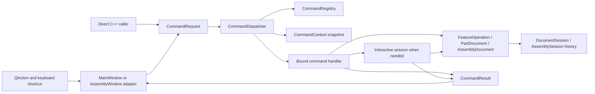
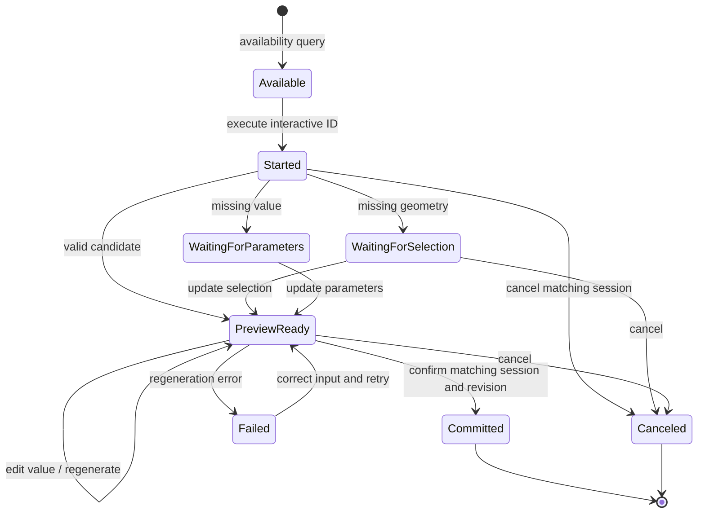
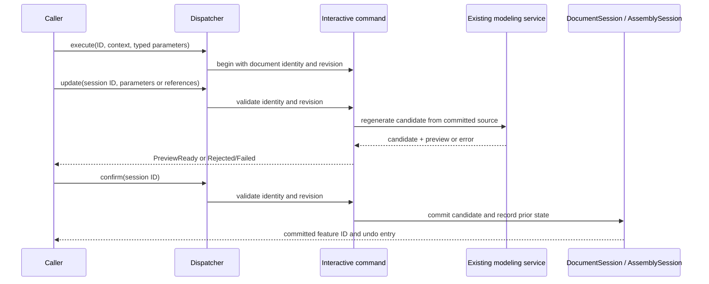
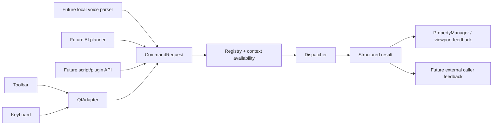

# TheCAD command system

This document describes the command infrastructure introduced on `codex/command-architecture`. It extends the [local command audit](command-system-audit.md). The new code lives in `src/application/CommandSystem.*`, `PartCommands.*` and `AssemblyCommands.*`; Qt adapters live in `src/ui/UiCommandAdapter.cpp`, `src/ui/assembly/AssemblyUiCommands.cpp`, `MainWindow.cpp` and `ReferenceGeometryUi.cpp`.

## Scope and ownership

`CommandRegistry` owns descriptions of stable, namespaced command IDs. `CommandDispatcher` reads a context value snapshot for each invocation, owns a handler table and at most one active interactive session. It has no Qt Widgets dependency. `CommandRequest` carries typed values, including millimeter lengths, radians, counts, directions, stable selection references, contour IDs and reference-geometry definitions. `CommandResult` reports status, session identity, affected feature IDs, an optional typed measurement and whether committed document state changed.

The existing `DocumentSession` and `AssemblySession` own documents and their ten-step histories. The command layer does not replace these. `PartCommands` and `AssemblyCommands` are widget-free hosts for representative commands and use the existing `FeatureOperation`, `PartDocument` and assembly document services. The Qt windows own action bindings, viewport state, PropertyManagers and display updates. No solver, OCCT algorithm, file format or history limit changed.

An interactive session receives updates addressed by its session ID. The dispatcher checks document identity and revision on each update and confirm. It rejects an update for another command or session. A caller may always cancel the current session. Failed preview leaves the committed document untouched and the session available for correction. Successful confirmation commits the candidate and records one history entry through the existing session. No preview enters history.



## Registration and availability

`registerBuiltInCommands(registry)` loads stable IDs and metadata. The descriptor contains a name, description, category, valid workspaces, parameter metadata, interactive classification and a `legacyBacked` flag. A command is **legacy backed** until a host binds an executable handler. Catalog enumeration is therefore different from executable availability. `availability(id)` rejects unknown IDs, wrong workspaces, commands without a bound handler, incompatible active operations and handler-specific preconditions, returning a reason and missing prerequisite names.

The catalog includes currently named Part, Sketch, Feature, Reference, Inspection, View, File and Assembly actions. Some contextual menu actions are still created dynamically in the UI and lack a formal descriptor; they remain legacy UI routes. For migrated Qt actions, the existing `QAction::objectName` and shortcut remain unchanged. Stable command IDs are separate from these names.

Part window availability for Extrude/Cut and Reference Plane currently delegates its final UI predicate to the existing QAction enabled state. This preserves established selection and PropertyManager behavior during migration, while `PartCommands` uses independent application checks for direct invocation. A later migration should move the profile/datum preconditions into shared application validators and make the QAction consume that result.

## Context and references

`CommandContext` is a value snapshot. It carries document identity/revision, document type, workspace, active sketch/operation, current selection, topology generation, modeling mode, units, viewport capability and history availability. Window adapters construct it from existing authoritative session and viewport state. No `QWidget*` is stored in the context. Session identity changes when a document is replaced or reset; the dispatcher rejects later updates from a previous document.

For topology selections, the dispatcher rejects a generation mismatch. The Part document still resolves actual geometry references and conservatively rejects missing topology, including solid faces whose source has changed. The command system never chooses a replacement face, edge or vertex by index alone. Callers should retain stable `SelectionRef`/`GeometryReference` data, not raw Qt items or unversioned OCCT shape handles.

## Typed parameters and lifecycle

Numerical parameters are values, not display strings: `Length{25}` means 25 mm, `Angle` stores radians, and `Count`/`Direction` are distinct types. `DatumDefinition` retains the existing reference geometry method and geometry references. A request may specify `expectedRevision` to reject stale work before it begins. The dispatcher checks parameter types on execute; interactive handlers validate their own update values and geometry constraints. Invalid values return `Rejected` without a commit.



Simple commands such as `view.isometric` are immediate. Sketch Line uses an interactive session that remains active across repeated mouse-created lines; Escape or switching tools ends it. Extrude/Cut and Reference Plane start existing docked PropertyManagers. Their typed updates change the same live operation settings; existing buttons and Enter/Escape paths confirm or cancel via the session. A wrong session ID cannot confirm a different operation.

## Mutation and undo



`PartCommands` demonstrates the application transaction rule with Extrude and Reference Plane: candidate document creation uses existing model APIs, cancel discards the candidate, and confirm installs it and records one prior snapshot. `AssemblyCommands` uses `AssemblySession::commit` for Fix/Float. Qt feature commits continue to validate display through `MainWindow::applyModel` before installing the candidate. Existing sketch and other solid-feature paths remain on their established history routes.

## Supported direct C++ example

The following API is implemented and covered by `application.commands`. The caller must supply a `PartDocument` with a single closed sketch and select that sketch’s feature ID. If multiple contours exist, pass a `modeling::RegionReferences` value in the update as `"regions"`.

```cpp
thecad::application::PartCommands host(std::move(partDocument));
host.session().selectedFeatureId() = sketchFeatureId;
auto& commands = host.dispatcher();

auto start = commands.execute({"feature.extrude"});
thecad::application::CommandRequest depth{"feature.extrude"};
depth.parameters["depth"] = thecad::application::Length{25.0};
auto preview = commands.update(start.sessionId, depth);
if (preview.state == thecad::application::CommandState::PreviewReady) {
    auto result = commands.confirm(start.sessionId);
    // result.affectedIds contains the new feature; result.documentChanged is true.
}
```

`host.session().document()` remains unchanged after the preview. `commands.cancel(start.sessionId)` discards the candidate. A direct caller can also dispatch `reference.plane` with a typed `modeling::DatumDefinition` and can dispatch `assembly.fix_float` through `AssemblyCommands`. The API needs no QWidget or simulated pointer event.

## Qt integration and migration status

| Command | Part/Assembly UI route | Widget-free host | Status |
|---|---|---|---|
| `view.isometric` | Part QAction and shortcut dispatch | Part host accepts a viewport callback | Migrated |
| `edit.undo`, `edit.redo` | Part and Assembly actions/shortcuts dispatch | Both hosts traverse existing sessions | Migrated for these entry points |
| `sketch.line` | Part QAction dispatches; viewport retains mouse gesture | Part host activates `SketchToolController` | Tool activation migrated; drawing gesture remains viewport owned |
| `feature.extrude`, `feature.extruded_cut` | Part actions dispatch; existing PropertyManager supplies contour and preview UI | Part host accepts typed depth, sketch and regions | Start/update/confirm/cancel migrated; UI selection validation remains in the existing panel |
| `reference.plane` | Part action dispatches; existing PropertyManager supplies references | Part host accepts typed `DatumDefinition` | Start/update/confirm/cancel migrated; UI reference picker remains existing |
| `inspect.measure` | Part action dispatches and shows existing readout | Part host resolves a selected current-generation edge/face/vertex and returns `modeling::Measurement` | Migrated; UI retains its existing richer readout and overlays |
| `assembly.fix_float` | Assembly action dispatches | Assembly host commits through `AssemblySession` | Migrated |
| `assembly.mate` | Existing PropertyManager callback | No direct command handler | Cataloged legacy |
| Other named commands | Existing action/viewport/panel callbacks | Existing document/modeling APIs vary | Cataloged legacy unless bound by a host |

The descriptor’s `legacyBacked` flag is cleared **per dispatcher instance** when that host binds a handler. A built-in catalog by itself does not promise a headless capability. `availability()` is the authoritative way to check whether a given host can execute a command.

## Adding a command

1. Add a stable namespaced descriptor and typed parameter metadata to `registerBuiltInCommands`. Do not derive the ID from a QAction label or `objectName`.
2. Implement or reuse an application/document/modeling service for the work. Geometry algorithms stay below the command layer.
3. Bind an immediate or interactive handler in each supported document host. Return a structured result and an availability reason. Use `CommandSession` for multi-step operations.
4. For mutations, compute a candidate first; validate references and geometry; commit once through the existing document session; keep previews and cancel out of history.
5. Connect the QAction/shortcut to `execute` and bind PropertyManager controls to typed `update`, `confirm` and `cancel` calls. Preserve existing action object names during migration.
6. Add a non-GUI test for availability, stale context, preview, cancel, commit and undo/redo. Add a focused GUI test only for behavior that depends on Qt interaction.

## Adding an input adapter later



A future adapter should parse its own input into a stable ID and typed request, query availability, then call the same dispatcher. It must keep the session ID for later updates/Confirm/Cancel. Voice, AI and scripting code are not part of this milestone. No network call or speech dependency exists in the command path.

## Known limitations and next migration work

* The command catalog covers named top-level actions but not every dynamic contextual menu item. Some legacy commands have coarse workspace metadata until their handlers move.
* UI Extrude/Cut and Reference Plane still use existing PropertyManager widgets as their interactive parameter/selection store. The widget-free hosts demonstrate typed execution, but UI and direct hosts are not yet one shared typed draft implementation. Moving those PropertyManagers to a shared application draft would eliminate this remaining duplication.
* Part and Assembly have separate session/history implementations by design. Sketch mutations, non-extrude features, deletion, Mate and many context commands still use legacy wiring. Their identifiers are discoverable but unavailable through a dispatcher until bound.
* The widget-free Measure host currently accepts one or two solid vertices, edges or faces from the latest named body topology; sketch measurements and UI overlay settings remain in the existing Measure panel.
* The command context is a snapshot derived from the current UI/session. Non-UI callers must provide their own viewport capability when invoking view commands. A later selection adapter can unify part, sketch and assembly reference resolution further.
* The UI action enablement for Extrude/Cut and Reference Plane remains legacy authoritative. Migrating their full availability predicates into application validators is the next architecture task before exposing those UI draft handlers to automation.
