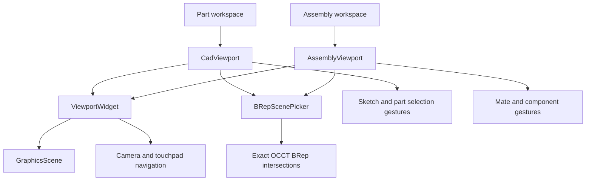

# Shared viewport architecture

The Part and Assembly workspaces use one native viewport foundation while
retaining independent document interactions. This keeps camera behavior,
Open CASCADE surface setup, DPI conversion and solid visibility queries
consistent without combining sketch editing and assembly mate state into a
single widget.

## Components

| Component | Responsibility |
| --- | --- |
| `ViewportWidget` | Shared Qt/OCCT viewport shell, graphics lifecycle, camera navigation, touchpad and wheel input, view commands, DPI conversion, common appearance. |
| `GraphicsScene` | Open CASCADE viewer, view and interactive context; surface synchronization and redraw. |
| `BRepScenePicker` | Cached exact BRep ray/face intersections, nearest visible face, instance transforms, depth occlusion and screen-space displayed-edge distance. |
| `CadViewport` | Part selection, sketch drawing/editing, dimensions, reference geometry and part-specific hover/selection presentation. |
| `AssemblyViewport` | Component presentation and transforms, mate reference selection, component drag gestures and assembly-specific highlights. |

The viewport base deliberately does not own a document, selection set, sketch
tool, assembly mate solver or modeling command. The workspaces provide
navigation pivots and zoom anchors through small virtual adapters.

## Implemented flow

`BRepScenePicker` receives an explicit scene of stable item IDs, shapes,
placements and visibility. It transforms each world-space ray into the item's
local coordinates for intersection, then returns the closest hit in world
coordinates with a local face index. Face ordering is based on camera depth,
so a rear component edge or face is rejected when an eligible front face
covers that screen position. Hidden items are excluded. Assembly transforms
remain per-instance data and do not duplicate cached source geometry.

The part workspace supplies its current body with an identity transform. The
assembly supplies each visible component and its placement. Existing workspace
selection policies still decide which kinds of topology are allowed in a given
mode, such as selecting only faces and edges while referencing geometry in a
sketch.

## Adding a viewport workspace

Derive a workspace viewport from `ViewportWidget`, initialize and synchronize
its presentation through the base helpers, and implement the navigation pivot.
Use `BRepScenePicker` for solid hit visibility and transformed-instance picks.
Keep workspace-specific gesture policy and selected-object presentation in
the derived adapter. Avoid adding document-specific logic to the base or the
picker.

## Limits

- Selection and hover presentation are intentionally workspace-specific; the
  viewport does not yet have a universal selection model.
- Sketch entities and reference datums use their existing specialized pickers.
- Assembly and Part still construct their own AIS presentations and react to
  their own document events.
- Screen-space edge distance uses the currently displayed triangulation. Exact
  BRep ray intersections remain authoritative for surface visibility.
